# Manual LUMBRE

**Descargar, activar, configurar y usar el programa, paso a paso y con las pantallas reales.**

Manual 1.0 · 24 de noviembre de 2026 · hecho con LUMBRE v1.9.673 · SMALLCAP MARKET SYSTEMS LLC · mariomaldonado.com

Las capturas salen del programa real. Los datos de la cuenta, los nombres de las estrategias y las cifras aparecen tapados con un bloque negro; en tu pantalla se leen completos.

> **Aviso de riesgo y de no asesoría.** Operar valores implica riesgo de pérdida, incluso de todo el capital, y no es adecuado para todas las personas. El rendimiento pasado no garantiza resultados futuros. SMALLCAP MARKET SYSTEMS LLC entrega este software solo como herramienta de ejecución. No da asesoría de inversión ni garantiza ganancias. Este manual explica cómo funciona el programa: no recomienda operar, ni cuándo, ni con cuánto. Las decisiones y sus consecuencias son tuyas.

## Cómo usar este manual

Tienes dos formas de usarlo.

**Leerlo tú.** Ve en orden la primera vez: capítulos 1 al 6 y ya estás operando. Del 7 en adelante es consulta.

**Dárselo a tu asistente de IA.** Sube este PDF (o el archivo `MANUAL-LUMBRE.md`, que trae lo mismo en texto) a ChatGPT, Claude, Gemini o el asistente que uses y dile:

> «Este es el manual de LUMBRE. Eres mi guía y mi soporte. Llévame paso a paso, un paso a la vez, y espera a que te confirme antes de seguir. Usa solo lo que dice el manual; si algo no viene, dímelo.»

El capítulo 15 está escrito para ese asistente: le dice cómo guiarte, qué no debe hacer y cómo diagnosticar cada problema.

### Índice

1. Lo que necesitas antes de empezar
2. Descargar e instalar
3. Los documentos que aceptas
4. Activar tu licencia
5. La pantalla principal
6. Set & Forget: seguir al maestro
7. Configuración: bróker, banco y límites
8. Estrategias: AUTO, banco, stop y objetivo
9. El menú Acciones de cada tarjeta
10. Telegram: controlar y recibir avisos en el celular
11. BanList, bloqueos, calendario y correo
12. Acciones globales, Linking, atajos y Settings
13. Actualizaciones
14. Si algo no sale
15. Instrucciones para tu asistente de IA
16. Soporte

---

## 1. Lo que necesitas antes de empezar

| Requisito | Detalle |
|---|---|
| Windows | Windows 10 u 11 de 64 bits. No hay versión para Mac ni para Linux. |
| Plataforma de operación | DAS Trader Pro instalado y abierto en la misma computadora. LUMBRE manda las órdenes a través de él. Dentro del programa lo verás escrito como **BROKER**. |
| Acceso API | Tu bróker tiene que habilitar el acceso por API de tu plataforma. Se le pide a él: escríbele a su soporte, pregunta el costo y pide también la documentación. Nosotros no lo activamos ni lo cobramos. |
| Cuenta de corretaje | Tuya y a tu nombre. El programa no opera cuentas de terceros. |
| Elegibilidad | La que firmas en la Declaración de Elegibilidad: residencia habitual en México, no ser ciudadano ni residente de Estados Unidos ni «U.S. Person», ser mayor de edad y usar capital que puedas permitirte perder. |
| Tu clave de licencia | Llega por correo después de la compra. Formato `SCE-XXXXXXXX-XXXXXXXX`. |
| Tu acceso de suscriptor | Usuario y contraseña del feed de alertas. Vienen en el mismo correo que la clave. |
| Espacio en disco | El archivo que descargas pesa unos 110 MB. |

Puedes abrir el programa sin la plataforma del bróker para conocerlo. Cuando no la encuentra te ofrece **PAPER MODE**: ves todo y no se manda nada.

---

## 2. Descargar e instalar

### Paso 1. Abre el correo de compra

El asunto es **«Tu licencia de SmallCap Market Systems»** y llega desde `info@mariomaldonado.com`. Trae tu clave, el enlace de descarga y tu acceso al feed de alertas. Guárdalo: la clave es tu comprobante.

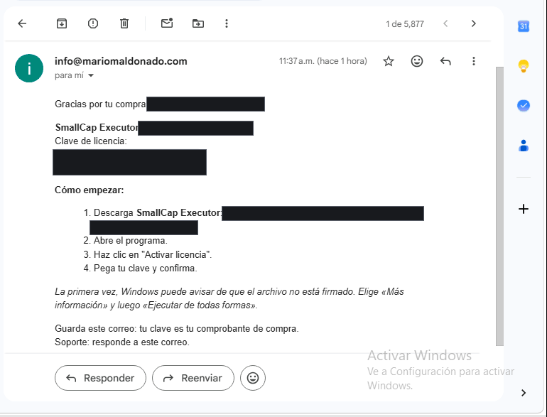

*El correo de compra. Captura de una versión anterior: hoy el correo dice «Producto: LUMBRE». La clave y el enlace aparecen tapados.*

### Paso 2. Descarga el programa

El enlace abre la página oficial de descargas:

`https://github.com/MarioMaldonadoH/smallcap-executor/releases/latest`

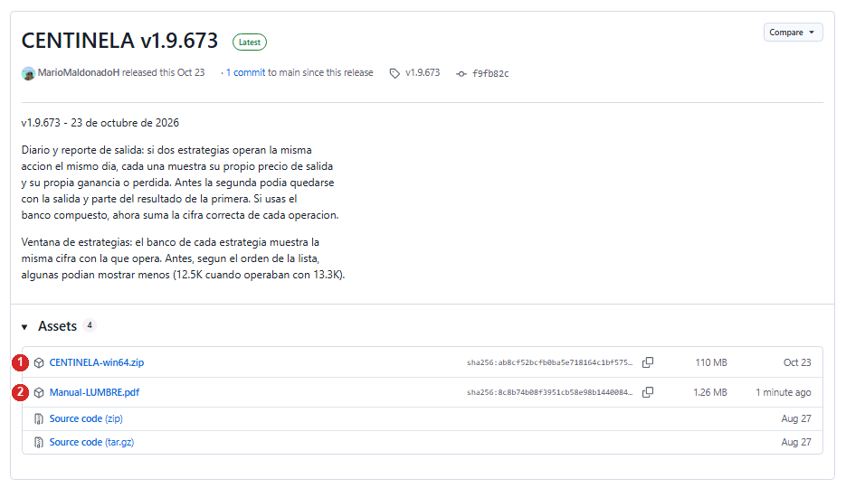

*La página de descargas. Abajo, en «Assets»: (1) el programa y (2) este manual.*

Ahí están dos archivos. Baja los dos con un clic en cada nombre:

- **`CENTINELA-win64.zip`**: el programa. Se llama CENTINELA porque el mismo programa sirve a dos productos; el tuyo se muestra como LUMBRE en cuanto activas la licencia.
- **`Manual-LUMBRE.pdf`**: este manual.

No descargues «Source code». No es el programa.

### Paso 3. Extrae el zip

En tu carpeta Descargas, clic derecho sobre `CENTINELA-win64` y elige **Extraer todo...**

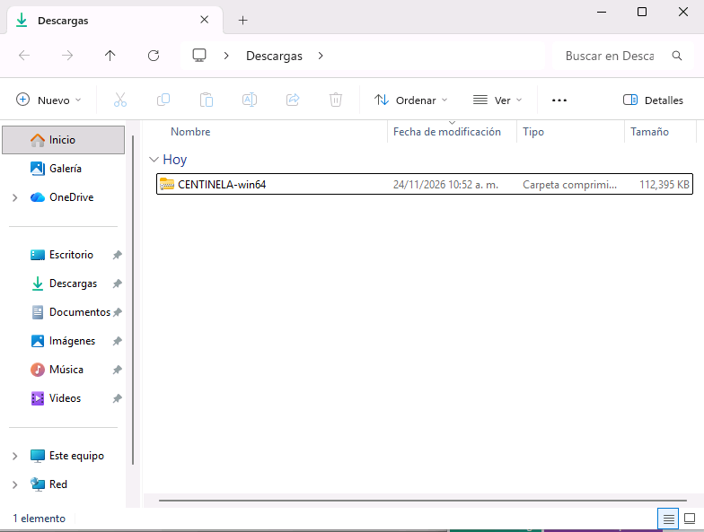

*El archivo recién descargado.*

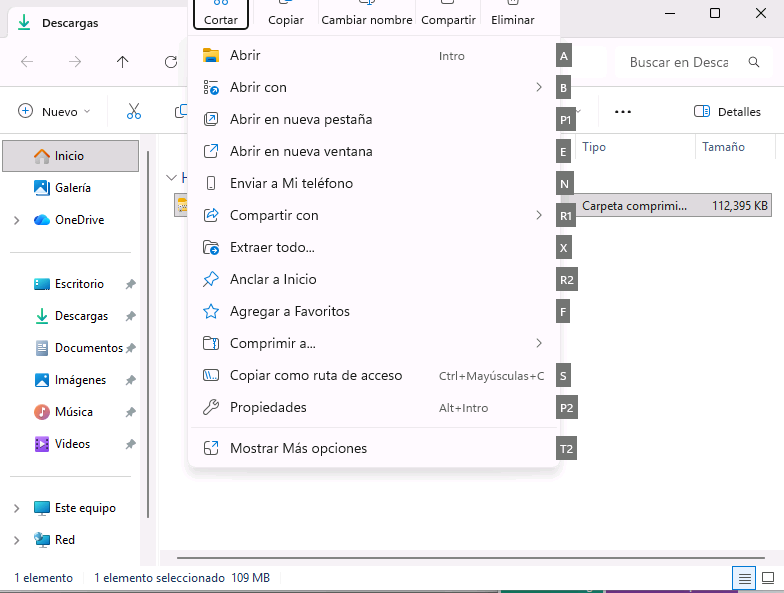

*Clic derecho → «Extraer todo...».*

Windows propone una carpeta dentro de Descargas. Déjala así y pulsa **Extraer**. Esa carpeta es temporal: el instalador copia el programa a su lugar definitivo en el paso 6.

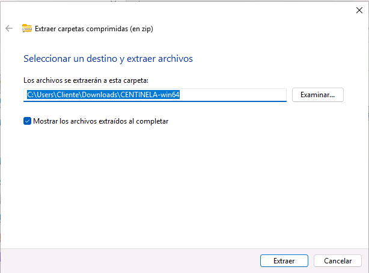

*Deja la ruta que propone y pulsa «Extraer».*

### Paso 4. Abre CENTINELA

Entra a la carpeta `CENTINELA`. Hay dos cosas: la aplicación **CENTINELA** y una carpeta **_internal**. Abre CENTINELA con doble clic. Las dos van siempre juntas: si mueves la aplicación sola, no arranca.

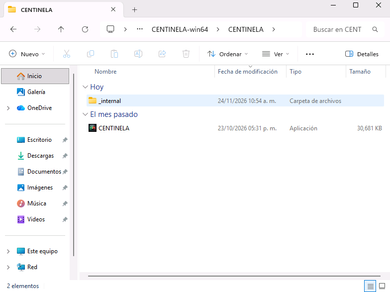

*Doble clic en CENTINELA. No muevas ni borres `_internal`.*

### Paso 5. El aviso azul de Windows

La primera vez, Windows muestra una pantalla azul: «Windows protegió su PC». Sale porque el archivo todavía no lleva firma digital de código. Pulsa **Más información** y luego **Ejecutar de todas formas**. El botón no aparece hasta que pulsas «Más información».

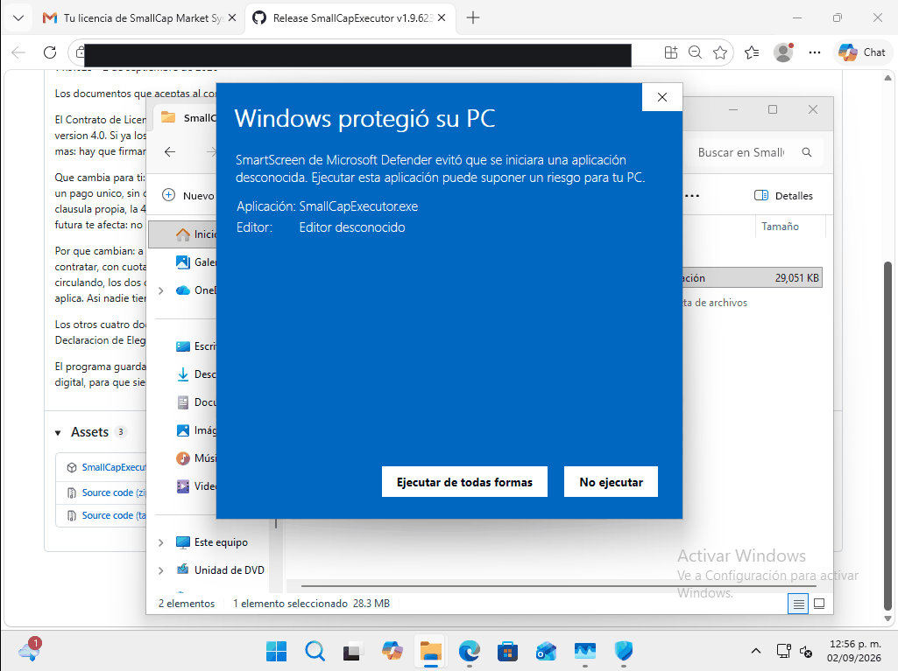

*Captura de una versión anterior: hoy la aplicación se llama `CENTINELA.exe`. El aviso es el mismo.*

Si en tu equipo no aparece «Ejecutar de todas formas» y Windows bloquea el archivo sin más, es el **Control inteligente de aplicaciones**. Se apaga en Seguridad de Windows → Control de aplicaciones y navegador.

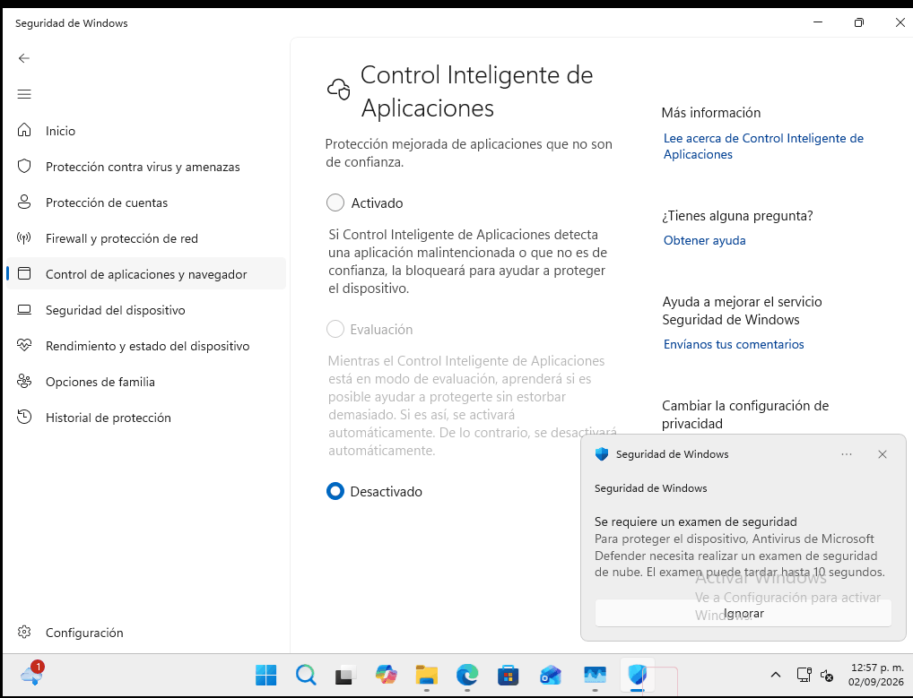

*Control inteligente de aplicaciones.*

> **Antes de apagarlo.** Esa función protege todo el equipo y apagarla es casi definitivo: para volver a encenderla hay que restablecer o reinstalar Windows. Prueba primero con «Más información». Apágala solo si no hay otra manera, y decídelo tú. SMALLCAP MARKET SYSTEMS LLC no se hace responsable de cambios en la seguridad de tu Windows.

### Paso 6. Elige dónde se instala

El programa pregunta dónde quiere quedarse y propone una carpeta en tu disco local. Pulsa **Instalar aquí (Recomendado)**.

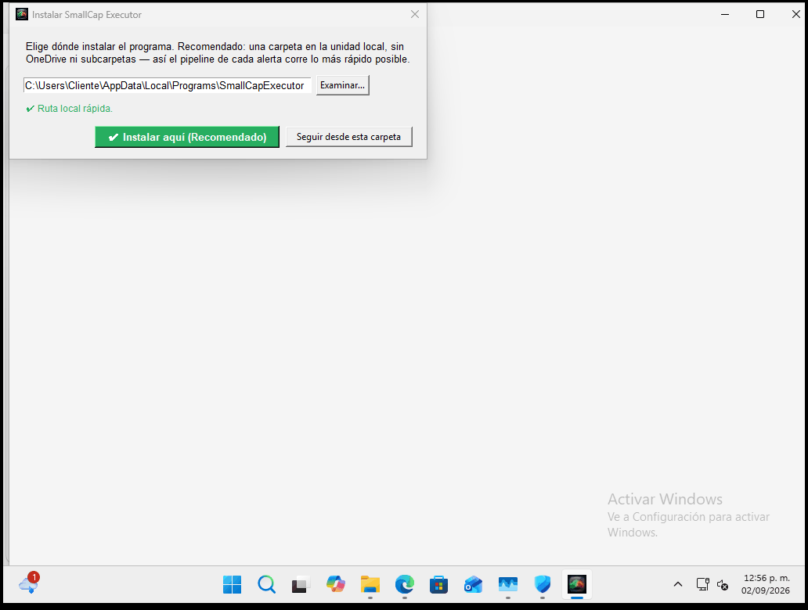

*La ruta recomendada está fuera de OneDrive: una carpeta sincronizada vuelve más lento el programa.*

Al terminar queda un acceso directo **CENTINELA** en tu escritorio. Desde ahí lo abres siempre. Ya puedes borrar el zip y la carpeta de Descargas.

---

## 3. Los documentos que aceptas

Antes de conectarte con el bróker, el programa muestra el aviso de riesgo y luego seis documentos. Son los mismos que aceptaste al comprar; se firman dentro del programa para que quede constancia de la versión.

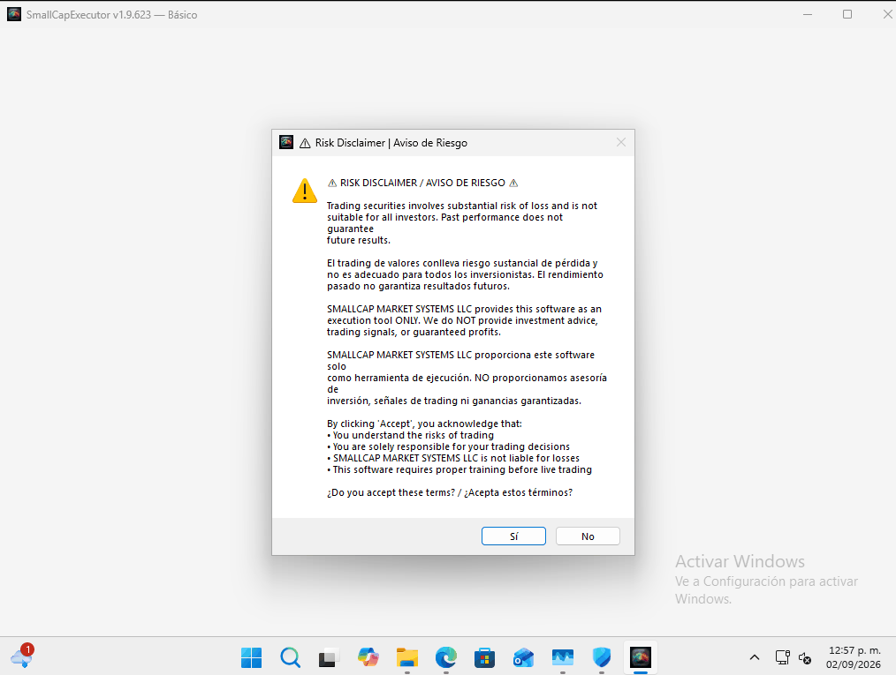

*El aviso de riesgo, en español e inglés.*

Los seis: contrato de licencia, términos y condiciones, aviso de riesgo, declaración de no asesoría financiera, aviso de privacidad y declaración de elegibilidad. Cada uno tiene su pestaña.

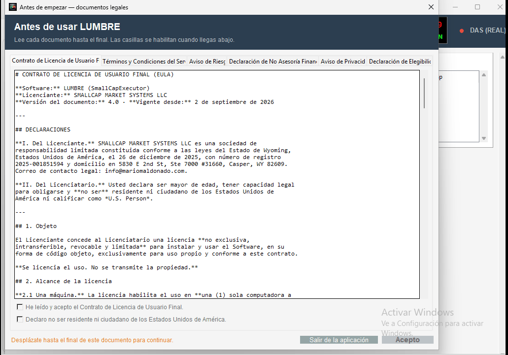

*Las casillas se habilitan cuando bajas hasta el final de cada texto. Si no puedes marcarlas, te falta bajar.*

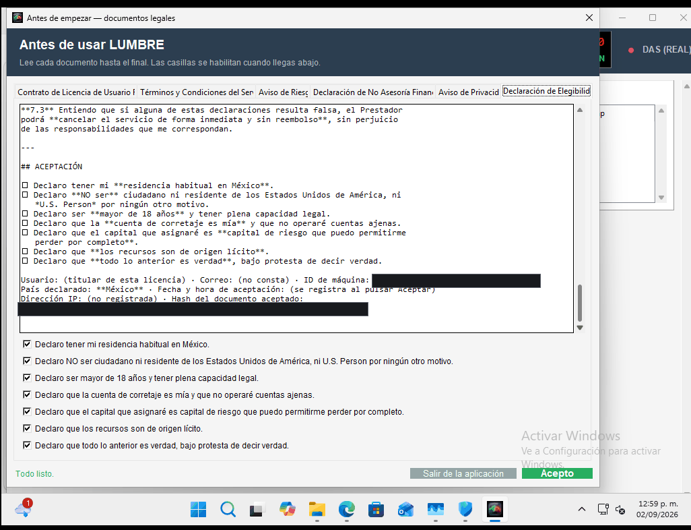

*La declaración de elegibilidad. El programa guarda la versión, la fecha y una huella de lo que aceptaste.*

Si publicamos una versión nueva de los documentos, el programa te los vuelve a mostrar al abrir. Aceptar la versión vigente es condición para conectar.

---

## 4. Activar tu licencia

Sin clave el programa abre, pero no carga tu plan. Son tres clics.

### Paso 1. Entra en PAPER MODE

Si la plataforma del bróker no está abierta, sale este cuadro. Pulsa **Entrar en PAPER MODE** (para activar la licencia no hace falta el bróker).

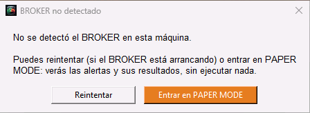

*No es un error: solo dice que no encuentra la plataforma del bróker abierta.*

### Paso 2. Menú → Conexión y Config → Activar licencia

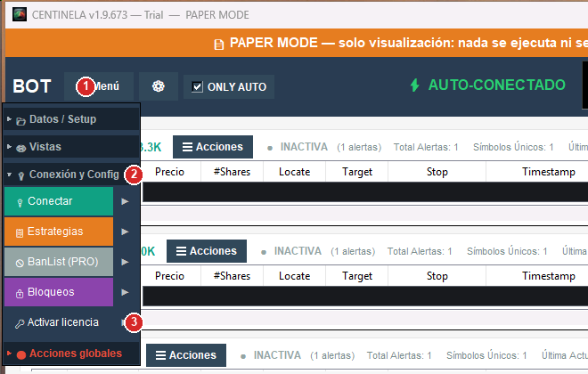

*(1) botón **Menú**, (2) sección **Conexión y Config**, (3) **Activar licencia**. Antes de activar, el título de la ventana dice «CENTINELA — Trial».*

### Paso 3. Pega tu clave y pulsa Activar

Copia la clave del correo, pégala en **Código** y pulsa **Activar**.

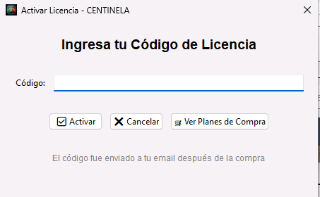

*Cuadro de activación.*

### Paso 4. Cierra el programa y vuelve a abrirlo

El plan se aplica al arrancar. Después de reabrir, el título de la ventana dice **LUMBRE** y la versión. Si sigue diciendo «Trial», la clave no entró: repite el paso 3.

### Una computadora por licencia

Si al activar ves **«No se pudo activar la licencia. max_machines_reached»**, la clave ya está registrada en otra computadora.

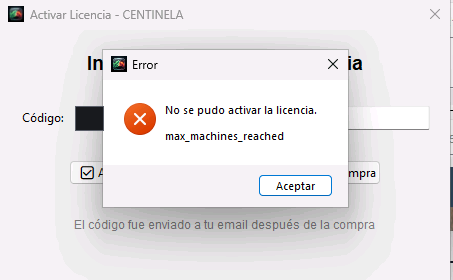

*Este mensaje significa «esta clave ya se activó en otro equipo».*

No se arregla desde el programa. Escribe a `info@mariomaldonado.com` desde el correo con el que compraste, di que cambiaste de equipo y espera la respuesta antes de volver a intentar. También pasa si reinstalas Windows o cambias piezas grandes del equipo.

---

## 5. La pantalla principal

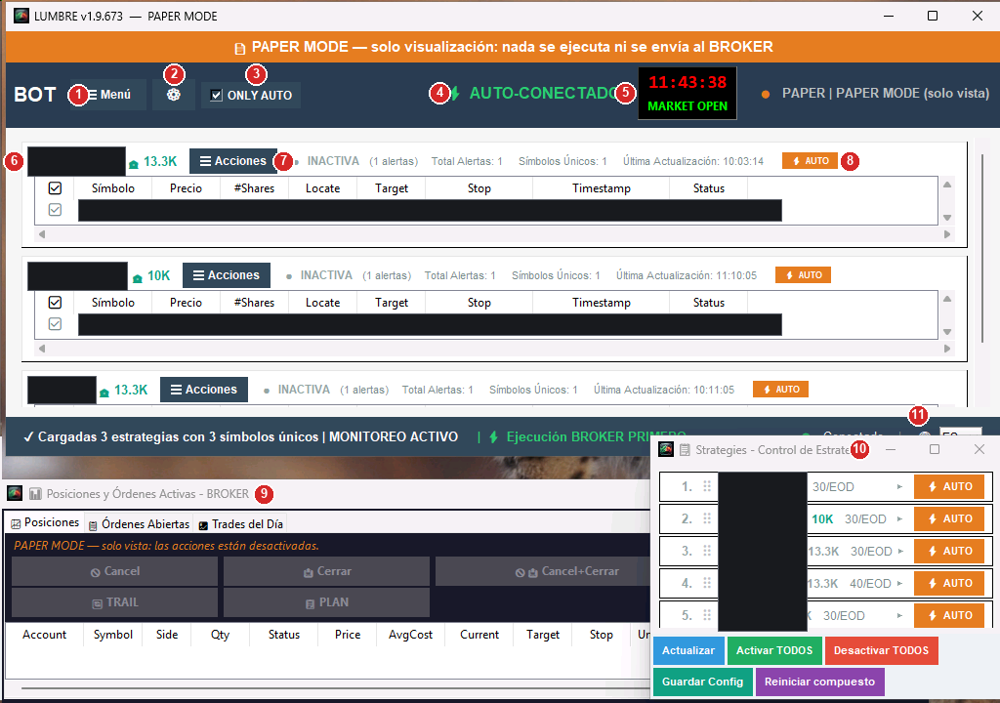

*La pantalla principal en PAPER MODE.*

| # | Dónde | Qué es |
|---|---|---|
| 1 | Botón **Menú** | Abre todas las ventanas (capítulos 6 al 12). |
| 2 | Engrane | **Settings**: guarda dónde acomodaste las ventanas. |
| 3 | Casilla **ONLY AUTO** | Oculta las estrategias que tienes en manual. Solo cambia lo que ves; las alertas se procesan igual. |
| 4 | Texto verde **AUTO-CONECTADO** | El programa está recibiendo alertas. |
| 5 | Reloj | Hora del Este (ET) y estado del mercado: MARKET OPEN, AFTER-HOURS, etc. |
| 6 | Tarjeta | Una por estrategia de tu plan. La cifra de al lado (por ejemplo 13.3K) es el banco de esa estrategia. |
| 7 | Botón **Acciones** | Lo que puedes hacer con esa estrategia o con un símbolo (capítulo 9). |
| 8 | Botón naranja **AUTO** | Enciende o apaga el automático de esa estrategia. |
| 9 | Ventana **Posiciones y Órdenes Activas** | Pestañas Posiciones, Órdenes Abiertas y Trades del Día, con botones Cancel, Cerrar, Cancel+Cerrar, RANGE, TRAIL y PLAN. |
| 10 | Ventana **Strategies** | La lista de tus estrategias con su banco, su stop y su salida (capítulo 8). |
| 11 | Barra inferior | Estado de la conexión y selector de idioma ES / EN. |

**Cómo se lee una alerta.** Cada fila de una tarjeta trae: Símbolo, Precio, #Shares (acciones calculadas con tu banco), Locate (costo estimado del préstamo), Target (objetivo; EOD = al cierre), Stop, Timestamp (hora ET) y Status (qué hizo el programa con ella).

*Ejemplo:* una fila con Precio 2.00, #Shares 500, Stop 2.60 (+30%) y Target EOD significa: 500 acciones a 2.00, stop en 2.60 y salida al cierre si no toca el stop. En PAPER MODE el Status dice PAPER y no se manda nada.

**La franja naranja.** Si arriba dice «PAPER MODE — solo visualización: nada se ejecuta ni se envía al BROKER», estás en modo de práctica. Para operar de verdad hay que conectar el bróker (capítulo 7).

### El menú completo

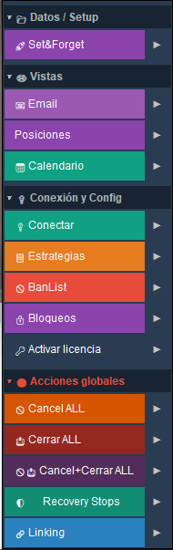

*Las opciones que tu edición no incluye no se dibujan: lo que ves es lo que puedes abrir. La flecha ► de cada renglón sirve para ponerle un atajo de teclado.*

| Sección | Opciones |
|---|---|
| Datos / Setup | Set&Forget |
| Vistas | Email, Posiciones, Calendario |
| Conexión y Config | Conectar, Estrategias, BanList, Bloqueos, Activar licencia |
| Acciones globales | Cancel ALL, Cerrar ALL, Cancel+Cerrar ALL, Recovery Stops, Linking |

---

## 6. Set & Forget: seguir al maestro

Aquí vive tu suscripción. **Dónde:** Menú → Datos / Setup → **Set&Forget**.

La primera vez pide el **usuario y la contraseña de suscriptor** que llegaron en tu correo de compra. No son los de tu bróker ni tu clave de licencia. Después el programa recuerda la sesión.

Tiene tres pestañas.

### Mi cuenta

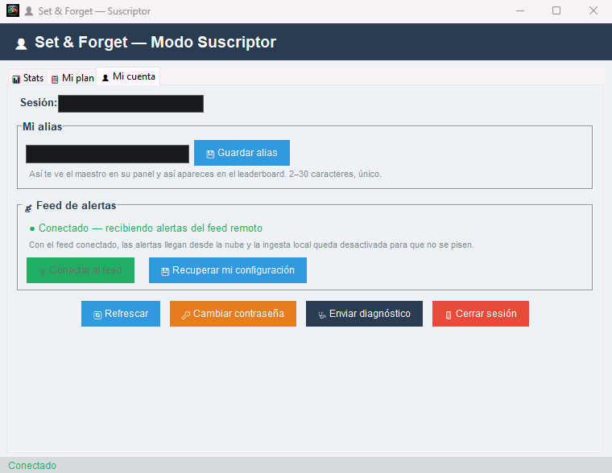

*Pestaña «Mi cuenta». El correo y el alias aparecen tapados.*

| Dónde | Qué hace |
|---|---|
| **Mi alias** + Guardar alias | El nombre con el que apareces en el panel del maestro y en el leaderboard. De 2 a 30 caracteres. |
| **Feed de alertas** | Tiene que decir en verde «Conectado — recibiendo alertas del feed remoto». Si no, pulsa **Conectar al feed**. |
| **Recuperar mi configuración** | Devuelve tus ajustes como los tenías. Es lo primero que conviene pulsar después de reinstalar. |
| **Refrescar** | Vuelve a leer tu cuenta. |
| **Cambiar contraseña** | Cambia la contraseña de suscriptor. |
| **Enviar diagnóstico** | Manda a soporte un reporte técnico de tu instalación. Púlsalo cuando soporte te lo pida. |
| **Cerrar sesión** | Sale de tu cuenta de suscriptor en este equipo. |

### Mi plan

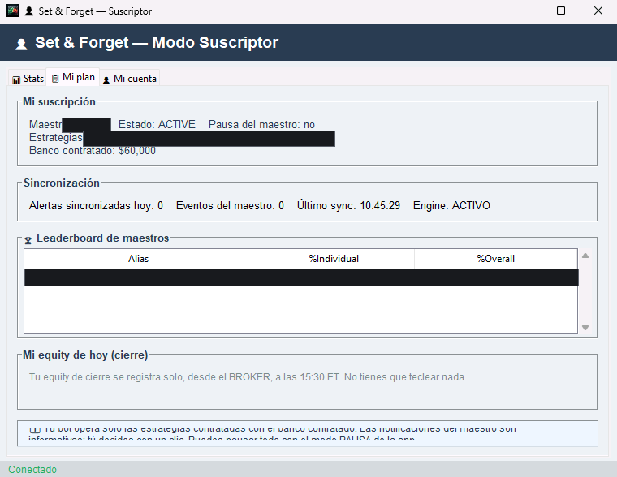

*Pestaña «Mi plan». El maestro, las estrategias y el leaderboard aparecen tapados.*

| Dónde | Qué dice |
|---|---|
| **Mi suscripción** | Tu maestro, el estado (ACTIVE = al corriente), si el maestro pausó, las estrategias de tu plan y tu banco contratado. |
| **Sincronización** | Cuántas alertas llegaron hoy, la hora de la última sincronización y **Engine: ACTIVO**. |
| **Leaderboard de maestros** | Comparativo informativo en porcentaje. |
| **Mi equity de hoy (cierre)** | Se registra solo, desde el bróker, a las 15:30 ET. No tecleas nada. |

Tu contrato fija un **número** de estrategias del catálogo vigente, no una lista cerrada. Si alguna cambia, se avisa conforme a tus términos.

### Stats

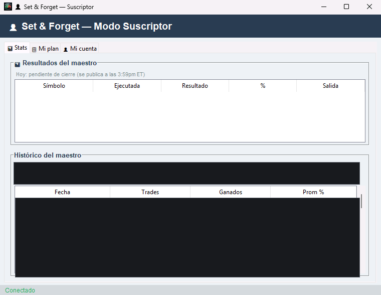

*Pestaña «Stats». Las cifras aparecen tapadas.*

- **Resultados del maestro (hoy):** qué alertas ejecutó, si ganó o perdió, el porcentaje y cómo salió. Se publica a las 3:59 pm ET; antes dice «pendiente de cierre».
- **Histórico del maestro:** día por día, en porcentaje. Nunca importes ni tamaños.

Es información del pasado. No es una promesa ni una recomendación.

### «Set and forget»: dejarlo trabajando en 6 pasos

1. Abre primero la plataforma de tu bróker e inicia sesión ahí.
2. Abre LUMBRE. En **Set&Forget → Mi cuenta** confirma que el feed dice «Conectado».
3. **Menú → Conectar**: revisa tu banco y tus límites (capítulo 7).
4. En **Strategies**, pon en **AUTO** solo las estrategias que entiendas (capítulo 8).
5. Pulsa **Guardar & Conectar**. Arriba debe decir AUTO-CONECTADO y desaparecer la franja naranja de PAPER MODE.
6. Deja la computadora encendida, con internet, con la plataforma del bróker y LUMBRE abiertos. A las 3:58 PM ET el cierre automático cierra lo que quede abierto.

Qué pasa cada día: llega la alerta → el programa revisa tus filtros (BanList, bloqueos, límites) → si la estrategia está en AUTO manda la orden con tu banco → coloca el stop → sale por stop, por objetivo o al cierre.

Para parar todo en cualquier momento: **Menú → Conectar → Guardar & Pause** (las alertas se muestran pero no se envían) o las **Acciones globales** (capítulo 12).

> En automático, el programa ejecuta las reglas que tú dejaste configuradas sin pedirte confirmación. Tú decides si lo activas, con cuánto capital y con qué límites. Las notificaciones del maestro son informativas.

---

## 7. Configuración: bróker, banco y límites

**Dónde:** Menú → Conexión y Config → **Conectar**. Se abre «Configuración del BROKER».

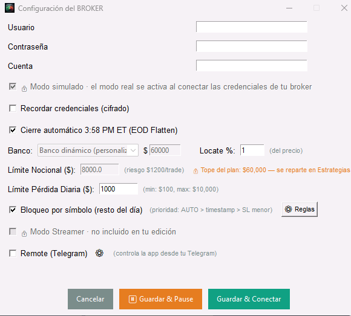

*Aquí decides cuánto riesgo asumes. Estos ajustes son tuyos; nosotros no los tocamos ni sugerimos valores.*

| Dónde (texto exacto) | Qué controla |
|---|---|
| **Usuario / Contraseña / Cuenta** | Los datos de tu plataforma de operación. Te los da tu bróker. |
| **Modo simulado** | Viene marcado y bloqueado. El modo real se activa solo al conectar con tus credenciales. |
| **Recordar credenciales (cifrado)** | Guarda cifrados esos datos en tu equipo. Viene apagado. |
| **Cierre automático 3:58 PM ET (EOD Flatten)** | Cierra lo que quede abierto antes del cierre del mercado. |
| **Banco** | El capital con el que trabaja el programa. El tope lo fija tu plan («Tope del plan») y se reparte entre tus estrategias. |
| **Locate %** | Cuánto aceptas pagar por el préstamo de acciones, como porcentaje del precio. |
| **Límite Nocional ($)** | Lo máximo que puede comprometer una sola operación. Al lado te dice el riesgo por operación que resulta. |
| **Límite Pérdida Diaria ($)** | Cuando la sesión llega a esa pérdida, el programa deja de abrir posiciones hasta el día siguiente. Entre 100 y 10,000. |
| **Bloqueo por símbolo (resto del día)** | Un símbolo que ya se operó no se vuelve a tomar ese día. El botón **Reglas** elige excepciones. |
| **Modo Streamer** | No incluido en LUMBRE. |
| **Remote (Telegram)** | Enciende el control por Telegram (capítulo 10). |
| **Cancelar** | Cierra sin guardar. |
| **Guardar & Pause** | Guarda y conecta en pausa: ves las alertas, no se envía nada. |
| **Guardar & Conectar** | Guarda y deja el programa operando. |

*Ejemplo:* con Límite Pérdida Diaria en 300, si entre operaciones cerradas pierdes 300 dólares en el día, aparece «LÍMITE ALCANZADO» y no se abre nada más hasta mañana. Las posiciones abiertas siguen con su stop.

### Reglas del bloqueo por símbolo

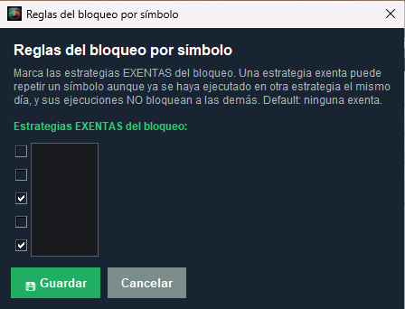

*Cada casilla es una estrategia de tu plan (nombres tapados).*

Una estrategia marcada como **exenta** puede repetir un símbolo que otra ya operó ese día, y sus operaciones no bloquean a las demás. Sin marcar ninguna, un símbolo se opera una sola vez al día.

---

## 8. Estrategias: AUTO, banco, stop y objetivo

**Dónde:** Menú → Conexión y Config → **Estrategias**. Se abre «Strategies — Control de Estrategias».

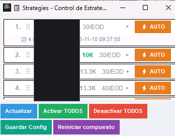

*Una fila por estrategia de tu plan (nombres tapados).*

Cada fila muestra el banco de esa estrategia (10K = 10,000), el stop en porcentaje y la salida (por ejemplo `30/EOD` = stop de 30% y salida al cierre) y el botón **AUTO**.

| Dónde | Qué hace |
|---|---|
| Botón **AUTO** de la fila | Naranja = esa estrategia se ejecuta sola. Apagado = espera tu clic. |
| Flecha ► | Muestra cuántos símbolos lleva y la última actualización. |
| Los seis puntos de la izquierda | Arrastra para cambiar el orden. |
| **Actualizar** | Vuelve a leer la lista. |
| **Activar TODOS / Desactivar TODOS** | Pone o quita AUTO en todas de un golpe. |
| **Guardar Config** | Guarda lo que cambiaste. Sin esto se pierde al cerrar. |
| **Reiniciar compuesto** | Regresa el banco compuesto a su punto de partida y descarta lo acumulado. |

### Ajustar una estrategia

Haz clic sobre el texto del stop y la salida de una fila (por ejemplo `30/EOD`). Se abre su cuadro de ajuste.

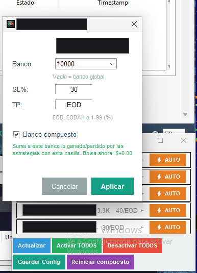

*Ajuste individual (nombre tapado).*

| Campo | Qué hace |
|---|---|
| **Banco** | El capital de esta estrategia. Vacío = usa el banco global. |
| **SL%** | El stop loss, en porcentaje. |
| **TP** | El objetivo: `EOD` (al cierre), `EODAH` (cierre con horario extendido) o un porcentaje de 1 a 99. |
| **Banco compuesto** | Con la casilla marcada, lo ganado o perdido se suma a ese banco. Apagada, el banco se queda como lo dejaste. |
| **Aplicar** | Guarda este ajuste. |

*Ejemplo:* Banco 10000, SL% 30 y TP EOD: la estrategia trabaja con 10,000 dólares, cada posición lleva un stop a 30% y lo que no toque el stop se cierra al final del día.

> El banco, el stop, el objetivo y el automático son tuyos y solo tuyos. SMALLCAP MARKET SYSTEMS LLC no los fija, no los modifica y no sugiere qué valores poner. Este manual dice qué hace cada campo; qué valor poner lo decides tú.

---

## 9. El menú Acciones de cada tarjeta

**Dónde:** botón **Acciones** en la cabecera de cada tarjeta.

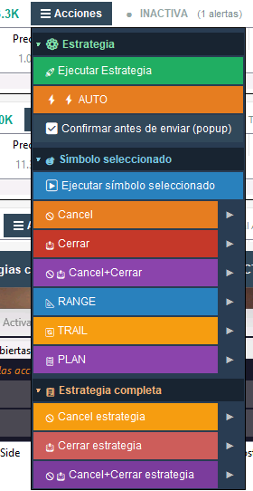

*Las tres secciones del menú Acciones.*

**Estrategia**

| Dónde | Qué hace |
|---|---|
| **Ejecutar Estrategia** | Manda ahora las alertas marcadas de esa tarjeta. |
| **AUTO** | Enciende o apaga el automático de esa estrategia. |
| **Confirmar antes de enviar (popup)** | Con la casilla marcada, el programa pregunta antes de mandar una orden manual. |

**Símbolo seleccionado** (primero haz clic en una fila de la tarjeta)

| Dónde | Qué hace |
|---|---|
| **Ejecutar símbolo seleccionado** | Manda solo esa alerta. |
| **Cancel** | Cancela las órdenes pendientes de ese símbolo. |
| **Cerrar** | Cierra la posición de ese símbolo. |
| **Cancel+Cerrar** | Las dos cosas, en ese orden. |
| **RANGE** | Pone un rango de salida: un precio de stop y un precio de objetivo. |
| **TRAIL** | Pone un stop que sigue al precio, en dólares (0.20) o en porcentaje (10). |
| **PLAN** | Arma un plan de órdenes escalonadas con su stop y su objetivo. |

**Estrategia completa**

| Dónde | Qué hace |
|---|---|
| **Cancel estrategia** | Cancela todas las órdenes pendientes de esa estrategia. |
| **Cerrar estrategia** | Cierra todas sus posiciones. |
| **Cancel+Cerrar estrategia** | Las dos cosas. |

*Ejemplo:* tienes una posición abierta en un símbolo y quieres salir ya. Clic en su fila → Acciones → **Cancel+Cerrar**: se cancela su stop pendiente y se cierra la posición.

Los mismos botones (Cancel, Cerrar, Cancel+Cerrar, RANGE, TRAIL, PLAN) están en la ventana **Posiciones y Órdenes Activas**. En PAPER MODE aparecen desactivados.

---

## 10. Telegram: controlar y recibir avisos en el celular

Con Telegram recibes un aviso cada vez que el programa ejecuta, y puedes pausar o consultar desde el celular. Solo funciona mientras LUMBRE está abierto en tu computadora.

**Dónde:** Menú → Conexión y Config → **Conectar** → renglón **Remote (Telegram)** → engrane ⚙.

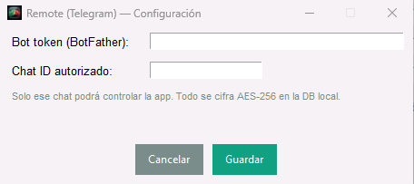

*Dos datos: el token del bot y tu Chat ID.*

### Paso 1. Crea tu bot y copia el token

1. En Telegram busca **@BotFather** y ábrelo.
2. Escríbele `/newbot`.
3. Te pide un nombre (el que quieras) y un usuario que termine en `bot` (ejemplo: `mi_lumbre_bot`).
4. Te contesta con el **token**: un número, dos puntos y una cadena larga de letras. Cópialo completo.

### Paso 2. Averigua tu Chat ID

1. En Telegram busca **@userinfobot** y escríbele `/start`.
2. Te contesta con tu **Id**: un número. Cópialo.

### Paso 3. Dale permiso a tu bot

Busca tu bot por el usuario que elegiste y escríbele `/start`. Sin este paso Telegram no deja que el bot te escriba.

### Paso 4. Pega los dos datos y enciende

1. En el cuadro de la foto, pega el token en **Bot token (BotFather)** y el número en **Chat ID autorizado**. Pulsa **Guardar**.
2. De vuelta en Configuración del BROKER, marca la casilla **Remote (Telegram)**.

Si dice «Chat ID inválido (numérico)», pegaste algo que no es solo números. Si el token no entra, cópialo otra vez completo desde BotFather.

### Qué puedes hacer desde el celular

Escribe `/menu` a tu bot. Aparecen estos botones:

| Botón | Qué hace |
|---|---|
| **Info del día** (`/dia`) | Tu equity, tu resultado del día, comisiones y posiciones, leídos de tu bróker. |
| **Posiciones** (`/pos`) | Tus posiciones abiertas, con botones para actuar sobre cada una. |
| **Banco** | Ver o cambiar el banco. |
| **Daily Loss Limit** | Ver o cambiar el límite de pérdida diaria. |
| **BanList** | Ver, agregar o quitar símbolos prohibidos. |
| **Bloqueo símbolo** | Encender o apagar el bloqueo por símbolo. |
| **Pausa / Reanudar** | Lo mismo que Guardar & Pause y Guardar & Conectar. |
| **Estado** (`/status`) | Si está conectado, pausado, tu banco y tus límites. |

Además te llegan solos: el aviso de cada entrada ejecutada, cada salida, el cierre del día, los avisos de tu plan y los días festivos del mercado.

### Seguridad

- Solo el chat que autorizaste puede controlar el programa. Mensajes de cualquier otro chat se ignoran.
- Toda acción que manda órdenes pide **dos toques**: el botón y luego «Confirmar». La confirmación caduca a los 2 minutos.
- El token y el Chat ID se guardan cifrados en tu equipo. Los avisos no incluyen tu número de cuenta.
- No compartas tu token con nadie. Si se filtra, en BotFather escribe `/revoke` y genera otro.

---

## 11. BanList, bloqueos, calendario y correo

BanList y Bloqueos son dos filtros distintos: uno lo decides tú y dura hasta que lo quites; el otro lo pone el programa y dura un día.

### BanList: símbolos que nunca quieres operar

**Dónde:** Menú → Conexión y Config → **BanList**.

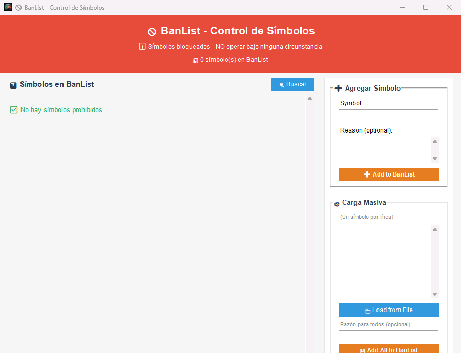

*BanList vacía.*

| Dónde | Qué hace |
|---|---|
| **Symbol** + **Add to BanList** | Agrega un símbolo. **Reason** es opcional: anota por qué. |
| **Carga Masiva** | Pega una lista, un símbolo por renglón, y pulsa **Add All to BanList**. |
| **Load from File** | Carga la lista desde un archivo de texto. |
| **Buscar** | Busca un símbolo en tu lista. |

*Ejemplo:* agregas ABCD. Aunque llegue una alerta de ABCD con la estrategia en AUTO, el programa no la opera hasta que lo quites de la lista.

### Bloqueos por símbolo: solo hoy

**Dónde:** Menú → Conexión y Config → **Bloqueos**.

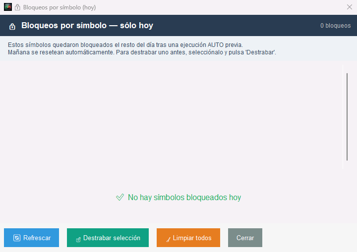

*Bloqueos del día.*

Cuando el automático ya ejecutó un símbolo, queda bloqueado el resto del día. Mañana la lista amanece vacía. Para liberar uno antes: selecciónalo y pulsa **Destrabar selección**. **Limpiar todos** los libera todos.

### Calendario de mercado

**Dónde:** Menú → Vistas → **Calendario**.

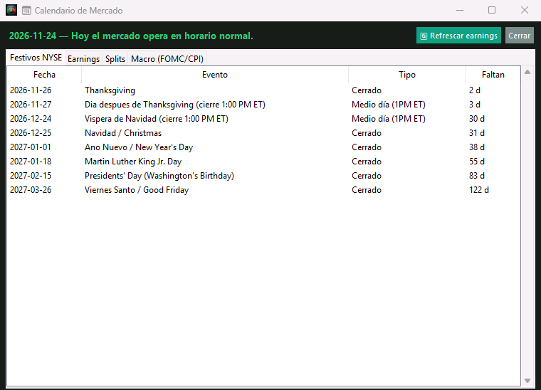

*Pestañas: Festivos NYSE, Earnings, Splits y Macro (FOMC/CPI).*

Arriba dice si hoy el mercado opera normal. La lista trae los días cerrados y los de media sesión (cierre a la 1:00 PM ET). **Refrescar earnings** actualiza las fechas de reportes.

### Avisos por correo

**Dónde:** Menú → Vistas → **Email**.

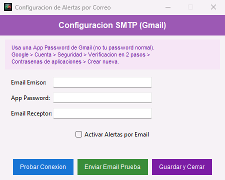

*Funciona con Gmail.*

1. En tu cuenta de Google: Seguridad → Verificación en 2 pasos → Contraseñas de aplicaciones → crea una. Google te da 16 letras.
2. **Email Emisor:** tu Gmail. **App Password:** esas 16 letras (no tu contraseña normal). **Email Receptor:** dónde quieres recibir los avisos.
3. Marca **Activar Alertas por Email**.
4. **Probar Conexion** revisa los datos; **Enviar Email Prueba** te manda uno de ejemplo; **Guardar y Cerrar** lo deja listo.

La contraseña de aplicación se guarda en tu equipo. Puedes revocarla cuando quieras desde tu cuenta de Google.

---

## 12. Acciones globales, Linking, atajos y Settings

### Acciones globales: parar todo

**Dónde:** Menú → **Acciones globales**. Todas piden confirmación.

| Dónde | Qué hace |
|---|---|
| **Cancel ALL** | Cancela todas las órdenes abiertas, de todas las estrategias y símbolos. No cierra posiciones. |
| **Cerrar ALL** | Cierra todas las posiciones. |
| **Cancel+Cerrar ALL** | Cancela todo y cierra todo. Es el botón de «quiero quedar en cero». |
| **Recovery Stops** | Revisa tus posiciones abiertas y coloca un stop de emergencia a las que no tengan uno. No duplica stops. |

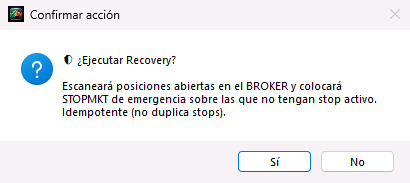

*Recovery Stops pregunta antes de actuar.*

*Ejemplo:* se fue la luz, reabres y no sabes si tus posiciones conservaron su stop. Menú → Acciones globales → **Recovery Stops** → Sí.

### Linking

**Dónde:** Menú → Acciones globales → **Linking**.

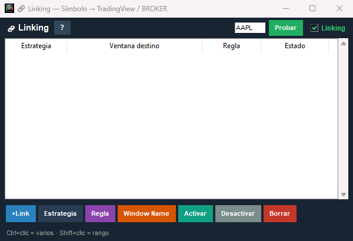

*Linking.*

Hace que, al seleccionar un símbolo en LUMBRE, ese símbolo se cargue en otra ventana tuya (tu gráfica o la plataforma del bróker). **+Link** agrega una ventana destino, **Probar** manda un símbolo de prueba, y la casilla **Linking** lo enciende o apaga. Es comodidad: no afecta la operación.

### Atajos de teclado (hotkeys)

**Dónde:** la flecha ► a la derecha de cualquier renglón del menú o del menú Acciones → **Configurar hotkey...**

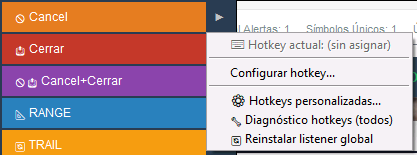

*Cada acción puede tener su atajo.*

Recomendado: teclas **F13 a F24** desde un Stream Deck o teclado programable; casi ninguna plataforma de trading las usa. Una combinación con Ctrl, Alt o Shift la recibe la ventana que esté al frente: si es la plataforma del bróker, puede disparar una de sus propias teclas rápidas. El programa te lo advierte antes de guardar.

Los atajos sobre un símbolo actúan sobre la fila que tengas seleccionada y respetan la casilla «Confirmar antes de enviar».

### Settings: acomodo de ventanas

**Dónde:** el engrane junto al botón Menú.

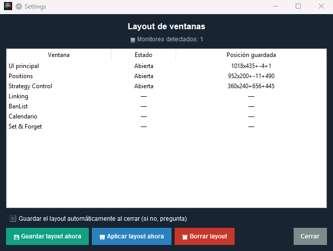

*Layout de ventanas.*

Acomoda las ventanas a tu gusto y pulsa **Guardar layout ahora**: la próxima vez abren en el mismo lugar. **Aplicar layout ahora** las regresa a lo guardado. **Borrar layout** olvida el acomodo.

---

## 13. Actualizaciones

El programa revisa si hay versión nueva **solo al abrir**. Si la hay, pregunta con un cuadro de Sí o No.

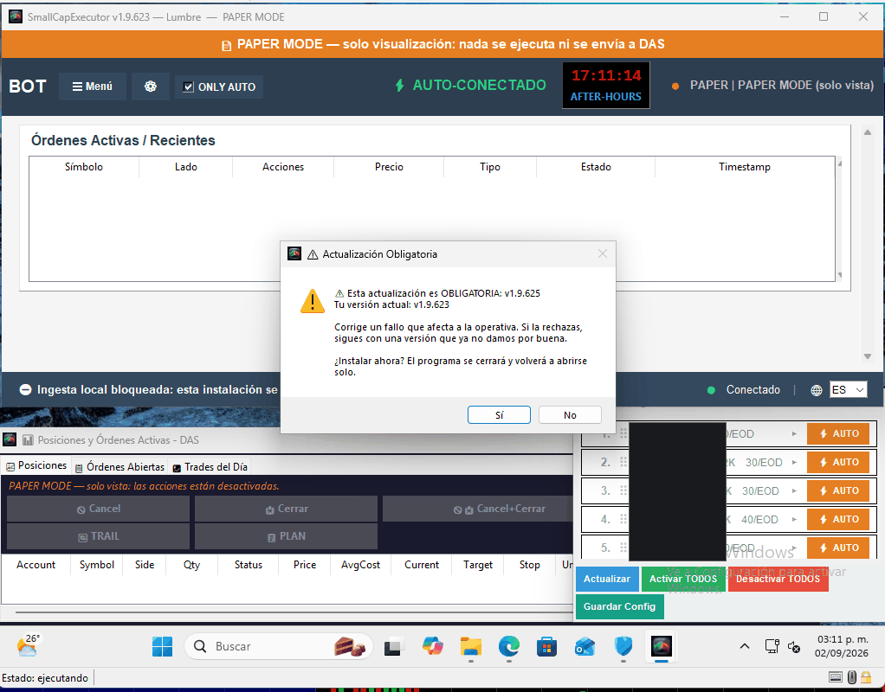

*Captura de una versión anterior. El aviso dice qué versión tienes y cuál es la nueva.*

- **Sí:** el programa se cierra, se actualiza y vuelve a abrirse solo. Puede tardar unos minutos y parecer detenido mientras descarga; déjalo terminar.
- **No:** sigues en tu versión.
- Mientras no contestes, el programa se queda esperando y **no opera**. Si lo dejas abriendo solo en la mañana, revisa que no se haya quedado en ese cuadro.

Tu licencia y tu configuración sobreviven a la actualización. Si algo se perdiera: Set&Forget → Mi cuenta → **Recuperar mi configuración**.

---

## 14. Si algo no sale

| Lo que ves | Por qué | Qué hacer |
|---|---|---|
| Pantalla azul «Windows protegió su PC» | El archivo no lleva firma digital todavía. | Más información → Ejecutar de todas formas (capítulo 2, paso 5). |
| Doble clic en CENTINELA y no abre | Moviste la aplicación sin su carpeta `_internal`. | Vuelve a extraer el zip y abre desde la carpeta completa. |
| «No se detectó el BROKER en esta máquina» | La plataforma del bróker no está abierta o aún está arrancando. | Ábrela, inicia sesión y pulsa **Reintentar**. Para solo mirar: **Entrar en PAPER MODE**. |
| El título dice «CENTINELA — Trial» | No hay licencia activa. | Capítulo 4. |
| Activé y sigo sin ver mi plan | El plan se carga al arrancar. | Cierra el programa por completo y ábrelo otra vez. |
| «max_machines_reached» | La clave ya está activada en otra computadora. | Escribe a soporte (capítulo 16). |
| No puedo marcar las casillas de los documentos | Se habilitan al final del texto. | Baja hasta abajo en cada pestaña. |
| Franja naranja «PAPER MODE» | No hay conexión con el bróker. | Menú → Conectar → tus credenciales → Guardar & Conectar. |
| «PAUSA activa — las alertas se muestran pero NO se envían al broker» | Conectaste con Guardar & Pause. | Menú → Conectar → Guardar & Conectar. |
| «PAUSADO POR TU MAESTRO» | El maestro pausó el servicio. | Esperar; lo ves en Mi plan → «Pausa del maestro». |
| No llegan alertas | El feed no está conectado o tu suscripción no está activa. | Set&Forget → Mi cuenta → **Conectar al feed**. En Mi plan revisa «Estado: ACTIVE». |
| Llegó la alerta y no se ejecutó | La estrategia no está en AUTO, el símbolo está en BanList o bloqueado, ya alcanzaste el límite de pérdida diaria, estás en pausa o en PAPER MODE. | Revisa esas cinco cosas en ese orden. La columna Status de la fila dice qué pasó. |
| «LÍMITE ALCANZADO» | Llegaste a tu límite de pérdida diaria. | El programa no abre más hoy. Mañana se reactiva solo. |
| Olvidé mi contraseña de suscriptor | Se recupera por correo. | En la pantalla de inicio de sesión de Set&Forget pide que te la reenvíen a tu correo. |
| Perdí el correo con mi clave | Puede estar archivado o en spam. | Búscalo por el asunto «Tu licencia de SmallCap Market Systems». Si no aparece, escribe a soporte desde el correo con el que compraste. |
| Telegram no contesta | LUMBRE está cerrado, la casilla Remote (Telegram) está apagada, o no le escribiste `/start` a tu bot. | Capítulo 10, pasos 3 y 4. |
| Reinstalé y perdí mis ajustes | Una instalación nueva arranca en blanco. | Set&Forget → Mi cuenta → Recuperar mi configuración. |
| El programa se quedó en un cuadro de actualización | Espera tu respuesta. | Contesta Sí o No (capítulo 13). |

---

## 15. Instrucciones para tu asistente de IA

*Este capítulo está escrito para el asistente de IA al que el cliente le entregó el manual.*

**Tu papel.** Eres la guía y el primer soporte de una persona que compró LUMBRE. Tu trabajo es que instale, active, configure y use el programa sin tener que escribirle al equipo de soporte por algo que ya está explicado aquí.

**Cómo guiar**

1. Pregunta primero en qué punto está: ¿ya descargó?, ¿ya instaló?, ¿qué dice el título de la ventana? Con «CENTINELA — Trial» falta activar; con «LUMBRE» ya está activado; con la franja naranja está en PAPER MODE.
2. Da **un paso a la vez** y espera confirmación. Usa el texto exacto de los botones tal como aparece en este manual, en negritas.
3. Si la persona manda una captura de pantalla, compárala con las de este manual y dile exactamente dónde hacer clic.
4. Si un mensaje de error no viene en el capítulo 14, dilo con claridad y pásala al capítulo 16. No inventes pasos, menús ni botones.
5. Habla sencillo. La persona no tiene por qué saber de sistemas.

**Si tienes acceso al correo de la persona** (y ella te lo pide)

- Busca el mensaje con asunto **«Tu licencia de SmallCap Market Systems»**, remitente `info@mariomaldonado.com`.
- De ahí salen tres cosas: la clave `SCE-XXXXXXXX-XXXXXXXX`, el enlace de descarga y el usuario y contraseña del feed de alertas.
- Díctale la clave solo a ella. No la pegues en ningún otro sitio ni la repitas en resúmenes.

**Lo que NO debes hacer**

- No recomiendes valores de banco, stop, objetivo, límites ni qué estrategias poner en AUTO. Explica qué hace cada campo; el valor lo decide la persona.
- No des consejos de inversión, no opines sobre si conviene operar y no prometas resultados. El software es una herramienta de ejecución.
- No pidas ni guardes contraseñas del bróker, de Gmail ni el token de Telegram. La persona los teclea directo en el programa.
- No le digas que apague el Control inteligente de aplicaciones sin antes advertirle que es casi irreversible (capítulo 2, paso 5).
- No expliques menús ni comandos internos de la plataforma del bróker: eso viene en la documentación que el bróker le entrega a su cliente. Si la persona te comparte esa documentación, puedes leerla y guiarla con ella.
- No intentes resolver un cambio de computadora, un cobro o una clave perdida: eso solo lo resuelve soporte.

**Orden de diagnóstico cuando «no funciona»**

1. ¿Abre el programa? Si no: aviso azul de Windows o carpeta `_internal` (capítulo 2).
2. ¿Qué dice el título? Trial → capítulo 4.
3. ¿Hay franja naranja de PAPER MODE? → falta conectar el bróker (capítulo 7).
4. ¿Set&Forget → Mi cuenta dice «Conectado»? Si no → Conectar al feed.
5. ¿Mi plan dice «Estado: ACTIVE» y «Pausa del maestro: no»?
6. ¿La estrategia está en AUTO? ¿El símbolo está en BanList o en Bloqueos? ¿Se alcanzó el límite de pérdida diaria? ¿Está en pausa?
7. Si todo lo anterior está bien y sigue fallando → capítulo 16, con los datos que ahí se piden.

**Respuestas rápidas**

| Pregunta | Respuesta |
|---|---|
| ¿Por qué el archivo se llama CENTINELA si compré LUMBRE? | Es el mismo programa. Al activar la licencia se muestra como LUMBRE. |
| ¿Tengo que dejar la computadora prendida? | Sí: el programa opera desde tu computadora, con la plataforma del bróker abierta. |
| ¿Funciona en Mac o en el celular? | No. Solo Windows 10 u 11. Desde el celular solo se controla por Telegram. |
| ¿Puedo usarlo en dos computadoras? | No. La licencia habilita una. |
| ¿Puedo probar sin arriesgar? | Sí, en PAPER MODE: ves las alertas y no se manda nada. |
| ¿Qué estrategias tengo? | Las que aparecen en Set&Forget → Mi plan. |
| ¿Quién decide el tamaño de cada operación? | El banco y los límites que la persona configuró. |
| ¿A qué hora cierra todo? | A las 3:58 PM ET, si el cierre automático está marcado. |
| ¿Cuánto cuesta / cómo cancelo / reembolsos? | Eso lo dicen sus términos y la web: mariomaldonado.com. No lo estimes. |

---

## 16. Soporte

Antes de escribir, revisa el capítulo 14 o pregúntale a tu asistente de IA con este manual.

Si de verdad no viene aquí: **info@mariomaldonado.com**, desde el correo con el que compraste. Manda todo esto en un solo mensaje para que se resuelva a la primera:

1. La versión, que sale en el título de la ventana (ejemplo: LUMBRE v1.9.673).
2. Qué estabas haciendo y qué esperabas que pasara.
3. El texto exacto del mensaje, o una captura de pantalla.
4. Si puedes: Set&Forget → Mi cuenta → **Enviar diagnóstico**, y di a qué hora lo mandaste.

Nunca mandes por correo la contraseña de tu bróker ni tu token de Telegram. Nadie de soporte te los va a pedir.

---

SMALLCAP MARKET SYSTEMS LLC · 5830 E 2nd St, Ste 7000 #31660, Casper, Wyoming 82609, Estados Unidos de América · info@mariomaldonado.com · mariomaldonado.com

Contenido educativo e informativo sobre el funcionamiento del software. No constituye asesoría financiera, de inversión, legal ni fiscal, ni una recomendación para comprar o vender ningún valor.
